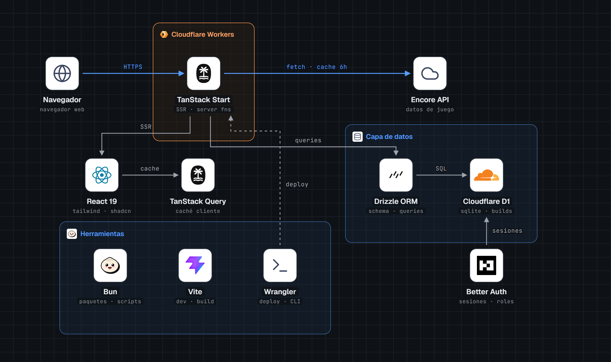
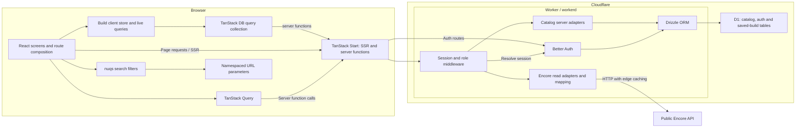
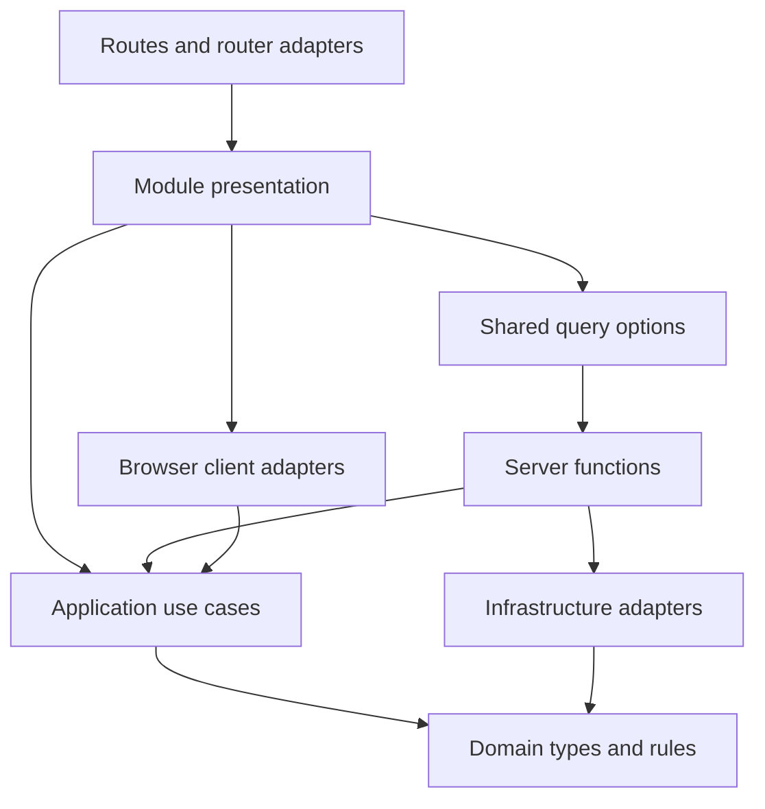

# Application architecture

Wuwa-builds is a content-first Wuthering Waves build generator. The canonical
catalog is stored in Cloudflare D1 and curated through the admin panel. The
builder reads that catalog and stores the user's working builds locally in the
browser.

The code is organized into feature modules with a light domain/application/
infrastructure split. TanStack Start provides routing, SSR and server functions;
Cloudflare Workers runs the server runtime.

## Stack overview



The image is a technology overview. The diagrams and flows below describe the
current implementation, including browser-local builds and the status of cloud
save.

| Concern                 | Implementation                                              |
| ----------------------- | ----------------------------------------------------------- |
| UI                      | React 19, Tailwind CSS v4, shadcn/ui and PanelUI components |
| Routing and SSR         | TanStack Start and TanStack Router                          |
| Remote data cache       | TanStack Query                                              |
| Local build state       | TanStack DB Query Collection over the D1 saved builds       |
| Search filter state     | nuqs, through a small typed hook factory                    |
| Server input validation | zod                                                         |
| Database access         | Drizzle ORM with Cloudflare D1                              |
| Authentication          | Better Auth with D1-backed auth tables                      |
| Server runtime          | Cloudflare Workers / workerd                                |
| Development and build   | Bun, Vite, React Compiler and Wrangler                      |

## Runtime boundaries



The build editor and My Builds use SSR. Their loaders preload the per-user
build collection, which the router hydrates for the browser.

The browser does not access D1 directly. Catalog and Encore network reads enter
through server functions. Build edits use the client store and persist to D1
through collection mutation handlers.

The Worker is not a general Node.js process. `nodejs_compat` is enabled, but
runtime code must still avoid filesystem and child-process dependencies. A
`.server.ts` suffix separates server code from the client bundle; it does not
make Node-only APIs available in workerd.

## Repository map

```text
src/
  routes/          File routes, loaders, the _navigation shell and session identity
  routing/         Router adapters and route-level pages
  modules/
    catalog/       Canonical catalog, admin UI and admin searches
    encore/        External game-data reads and source mapping
    build/         Local builds, editor, my builds UI and calculations
    home/          Landing hero presentation and background
    game-data/     Shared canonical category definitions and validation
  components/      Reusable UI primitives, blocks and form controls
  hooks/           Cross-feature interaction hooks and filter factory
  providers/       Query/DB client setup and theme provider
  functions/       Session server functions and authentication middleware
  db/              Drizzle schemas, relations and D1 client creation
  lib/             Authentication setup and small shared utilities
  styles/          Theme, base styles and application layout rules
  router.tsx       Router creation and Query/DB integration

drizzle/           Generated SQL migrations and schema snapshots
scripts/           Development utilities and the D1 migration runner
docs/              Architecture, builder contract and integration guides
wrangler.jsonc     Worker entry point, compatibility flags and D1 binding
vite.config.ts     Start, Cloudflare, React, Tailwind and compiler plugins
```

`src/routeTree.gen.ts` is generated by the file router. Route composition belongs
in `routes/` and `routing/`; feature modules must not import those folders or
TanStack Router.

### Route pages

A route file declares the route and renders one page component; the page owns the
visual shell. Catalog routes keep `CatalogNavigation` and their `ActionDock` in the
route file, so the page only describes content.

Pages compose `RouteNavigation` (`src/components/blocks/route-navigation`):

- `Root` sets the vertical rhythm and the variant; `Header` holds `Title`
  (`h1`), `Description` and `Actions`; `Content` holds the body.
- `variant="compact"` keeps the `max-w-5xl` column for lists, forms and details.
  `variant="extended"` spans the viewport with an inset header, for the admin
  menu and My Builds.
- `RouteNavigation.List` draws the responsive grid from the items it receives.
  It never reads data: the small component that suspends loads the items and puts
  the `Suspense` boundary around itself, never around the page.
- A page with several sections gives each one its own `Header` with
  `Title as="h2"`; nested headers use `variant="inline"` when the page column is
  already applied.
- `CatalogSection` and `EditableSection` are section-level APIs; they are not
  page chrome. Skeletons use `RouteNavigation` so the pending page has the same
  width as the loaded one.

## Feature modules

| Module      | Owns                                                                                                                                       | Main consumers                                                   |
| ----------- | ------------------------------------------------------------------------------------------------------------------------------------------ | ---------------------------------------------------------------- |
| `catalog`   | Canonical resonators, weapons, echoes and sonatas; zod inputs; D1 adapters; server functions; query options; admin screens and searches    | Admin panel and builder                                          |
| `encore`    | Public API reads, caching and conversion from external codes/localized names to internal values                                            | Admin search and create-form prefill                             |
| `build`     | Local build collection, user-scoped edits, editor and my builds UI, stat calculations, and the saved-build backend reserved for cloud save | Builder and My Builds                                            |
| `home`      | Landing hero, animated entrance and responsive images with pre-rendered dithering                                                           | Home route                                                       |
| `game-data` | Stable category IDs, labels, types, validation and select options                                                                          | Catalog, Encore adapters, build calculations and search controls |

Encore is an external content source. It is not the builder's catalog and is not
used as a fallback when D1 has no records. Admins decide which content to persist
in the canonical catalog; there is no scheduled Encore synchronization.

### Layers inside a module

Folders are added where the module needs them; every module does not need every
layer.

| Folder            | Responsibility                                                      |
| ----------------- | ------------------------------------------------------------------- |
| `domain/`         | Types and pure rules, without runtime I/O                           |
| `application/`    | Use cases, transformations and input schemas                        |
| `infrastructure/` | Concrete HTTP, D1 or LocalStorage adapters                          |
| `server/`         | TanStack server functions and middleware integration                |
| `queries/`        | Shared TanStack Query keys, query functions and freshness policies  |
| `client/`         | Browser state, reactive collection queries and controlled mutations |
| `presentation/`   | Feature UI, capability-specific components and interaction hooks    |



The diagram shows responsibility boundaries, not a requirement to introduce a
repository abstraction for every operation. Catalog server functions currently
include direct Drizzle operations as well as calls into infrastructure adapters.
Encore is the reference implementation for loading server-only use cases through
an `import()` inside the server handler.

Catalog summary types currently derive from Drizzle row types using type-only
imports. Domain calculations remain free of database calls.

## Main data flows

### Catalog reads and admin edits

1. A route composes a catalog screen and supplies route-owned navigation or IDs.
2. The screen uses shared options from `catalog/queries`.
3. The query invokes a function in `catalog/server`.
4. Middleware resolves the session. Reads require authentication; mutations
   require the `ADMIN` role and validate inputs with zod.
5. The server function reads or writes normalized D1 tables through Drizzle.
6. Successful admin mutations invalidate the relevant query keys so catalog and
   builder consumers can refresh.

Echo selection has a lightweight `echoQueries.selection()` query. It includes
sonata `setId`, `name` and `icon` metadata without loading skills or full detail
payloads for every result.

### Encore-assisted prefill

1. One of the three admin searches uses `encore/queries`.
2. An Encore server function loads its server-only read implementation.
3. The HTTP adapter requests the public API; the mapper removes unused lore
   fields and converts source categories into canonical IDs.
4. The selected record identifies the detail query used to prefill the admin
   form.
5. Submitting the validated form writes canonical records to D1 through the
   catalog module.

Selecting an Encore result is a prefill action, not an automatic catalog sync.
The HTTP adapter currently requests the Spanish API locale.

### Build editing

1. The My Builds and editor loaders preload the signed-in user's query collection
   (`id: builds:<userId>`, `queryKey: ["builds", userId]`) through the router's
   `DbClient`. The router hydrates it for the browser.
2. The collection reads `getMyBuilds` and hydrates every row with the catalog
   before materializing `BuildProps` (`client/hydrate-builds.ts`).
3. Live queries select builds belonging to the signed-in `userId`.
4. Search results come from catalog queries. Resonator and weapon selection hooks
   resolve details through the shared Query client before applying edits. Echo
   selection applies its summary immediately and warms the detail query.
5. `client/build-store` verifies ownership before updates and deletions.
6. Edits are optimistic and reactive. Updates are sent in order. Each mutation
   handler reads back the saved builds with `refetch`.
7. Calculation hooks combine the build with catalog details and run pure stat
   calculation functions. Derived totals are not persisted.

Changing a resonator resets its dependent skills, passives and weapon. Changing
an echo resets dependent echo stats. Those rules live in build application/domain
code rather than in generic search UI. The active editor section is screen state
in `EditorSectionProvider`, not part of the saved document.

### Saved builds in D1

Saved builds use the authenticated **user ID** as the only owner and a versioned
JSON payload (`documentVersion: 2`). A build is one row: the payload stores ids
and values, and the editor hydrates labels and catalog rows on read. The mapper
lives in `build/application/build-document.ts`.

The editor and My Builds screens read and write through the query collection
(`client/builds-collection.ts`), which calls the authenticated server functions.
Creates are idempotent on the client-owned build ID. `character_id` stays
nullable while the build has no resonator.

## Authentication and ownership

Better Auth stores users and sessions in D1 through its Drizzle adapter. Email and
password login and Discord OAuth are configured in `src/lib/auth.ts`.

- Route guards establish navigation context and display the appropriate screen.
- `authMiddleware` enforces authentication at server-function entry points.
- `adminMiddleware` additionally requires `session.user.role === "ADMIN"`.
- Roles are `USER | ADMIN`, default to `USER`, and cannot be set through client
  signup input.
- Build reads and mutations are scoped by the Better Auth `userId`: the
  collection is created per user and the D1 repository filters by owner in every
  statement, so an ID alone is not ownership. The session id is never used: it
  rotates on every sign-in.
- Saved-build repository calls use the authenticated user ID. Catalog freshness
  and build identity are separate concerns.

## Search architecture

There are six independent components: resonators, weapons and echoes for admin,
and the same three for builder. Each owns its query/results hook, controls, pure
filtering helper, trigger and selection behavior.

- Admin searches live in `catalog/presentation/searches` and read Encore.
- Builder searches live in `build/presentation/editor/searches` and read D1.
- `CommandSearch` provides presentation primitives. Each search controls `open`
  and decides when its selection handler closes the dialog.
- `createSearchFilters` only creates a typed nuqs hook from parsers. It does not
  receive query options, arrays, predicates or UI fields.
- Filters use namespaced URL parameters, replace history and shallow updates.
  Closing clears only that instance's fields; echo scopes include the slot.
- Source restrictions, including weapon compatibility, stay in the corresponding
  search's query/results hook. Presentation filters only narrow that source.

See [Search integration](SEARCH_INTEGRATION.md) for the folder layout, API and
examples.

## Cache and persistence policies

| Data                                  | Policy                                                                      |
| ------------------------------------- | --------------------------------------------------------------------------- |
| Global Query defaults                 | `staleTime: "static"`, `gcTime: Infinity`; focus/reconnect refetch disabled |
| Canonical D1 catalog queries          | 5-minute stale time, 24-hour garbage collection                             |
| Encore queries                        | 6-hour stale time, 24-hour garbage collection                               |
| Encore HTTP reads in a Worker isolate | 5-minute in-memory deduplication                                            |
| Encore HTTP subrequests               | 6-hour Cloudflare edge cache                                                |
| Build query collection                | Per-user scope; 30-second stale time; SSR preload                           |
| D1 saved-build payload                | User/build identity, `documentVersion: 2`, nullable `character_id`          |

The Query cache is a remote-data cache, not the local build document store.
Deploying a new Worker does not itself invalidate the Encore TTL. Catalog
mutations invalidate their relevant query keys; sonata-association edits also
invalidate the echo selection metadata query.

## Canonical data contracts

`game-data/domain/categories.ts` owns stable element, weapon-type and echo-class
IDs. Rarity and echo cost remain numeric. Labels are for display and are not
persisted as category identities.

`build/domain/stats.ts` owns `BuildStatKey`, stat units and labels. Catalog forms,
calculation code, icons and derived-stat UI use those same keys.

Encore conversion happens at its infrastructure boundary. New catalog writes
validate canonical values; there is no runtime category compatibility layer for
old local snapshots or translated IDs.

Echo Sonata links (`echo_sets`) keep only the link — `echoId`, `setId`, `name`
and `sortOrder`. The set icon is read through the `sonata` relation from
`sonata_sets`, so it cannot drift from the canonical set the panel edits.

Resonators carry three curation flags that are panel data, not Encore data:
`isVisible`, `isNew` and `isCollab`. A re-import through `saveCharacter`
captures them before the whole-document replace and re-applies them, so a
game sync never resets them. The builder's resonator search only lists rows
with `isVisible = true` through `getVisibleCharacters`, a public server
function (the visible roster is not sensitive; anonymous sessions can read
it) cached under the `characters()` query-key prefix so admin mutations
refresh it. The admin list stays unfiltered and authenticated because
hidden rows still need curation.

## Development and validation

Use Bun for scripts and package management. `bun run dev` serves the app with SSR
in workerd. An agent-owned development server must use another port, such as
`bunx vite dev --port 3100`; port `3000` belongs to the user's server.

Run `bun run typecheck`, relevant `bun test` suites and `bun run lint` for code
changes. Build-affecting changes also require `bun run build` and, when relevant,
`bunx wrangler deploy --dry-run`. SQL migrations are generated under `drizzle/`
and applied through the local or remote migration runner; application startup is
not a database migration step.

The architecture boundary test in `src/architecture/tests/module-boundaries.test.ts`
checks that feature modules do not depend on router code.

## Further reading and entry points

- [Builder UI contract](BUILDER_UI.md)
- [Search integration guide](SEARCH_INTEGRATION.md)
- [Editor implementation notes](../src/modules/build/presentation/editor/README.md)
- [Router and Query/DB integration](../src/router.tsx)
- [Authentication middleware](../src/functions/middlewares.ts)
- [Canonical category registry](../src/modules/game-data/domain/categories.ts)
- [Build calculation composition](../src/modules/build/application/calculation/resolve-build-calculation.ts)
- [Encore HTTP cache](../src/modules/encore/infrastructure/http.server.ts)
